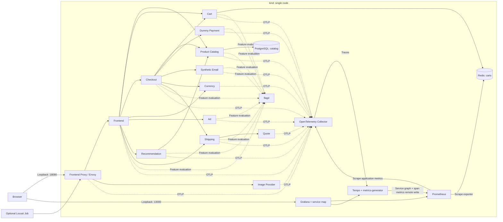

# E-Commerce Kubernetes Learning Lab

Deploy **ready-made container images** using readable, checked-in Kubernetes YAML. There is no application source tree, Dockerfile, image build, Node dependency installation, or manifest-generation program.

The application is the core [OpenTelemetry Astronomy Shop demo, release 3.1.0](https://github.com/open-telemetry/opentelemetry-demo/releases/tag/3.1.0), with Redis replacing its Redis-compatible Valkey cart store. PostgreSQL supplies catalog data. Grafana Tempo replaces the upstream tracing backend.

## Start reading here

```text
ecomm/
|-- README.md                    # Overview, architecture, setup, and limitations
|-- requirement.md               # Agreed scope and learning objectives
|-- cluster/
|   `-- kind.yaml                # One node: control plane and application workloads
|-- kubernetes/
|   |-- kustomization.yaml       # Explicit list of resources and configuration files
|   |-- namespace.yaml
|   |-- common/                  # Shared endpoints, SDK config, network policies
|   |-- frontend/manifest.yaml
|   |-- frontend-proxy/          # Envoy manifest and routing configuration
|   |-- product-catalog/manifest.yaml
|   |-- cart/manifest.yaml
|   |-- checkout/manifest.yaml
|   |-- payment/manifest.yaml
|   |-- email/manifest.yaml
|   |-- currency/manifest.yaml
|   |-- ad/manifest.yaml
|   |-- recommendation/manifest.yaml
|   |-- shipping/manifest.yaml
|   |-- quote/manifest.yaml
|   |-- image-provider/manifest.yaml
|   |-- flagd/                   # Feature-flag manifest and default flags
|   |-- redis/manifest.yaml
|   |-- postgres/                # Manifest, bootstrap script, and catalog schema
|   |-- otel-collector/          # Manifest and telemetry pipeline configuration
|   |-- tempo/                   # Manifest and service-graph configuration
|   |-- prometheus/              # Manifest, scrape configuration, example alerts
|   |-- grafana/                 # Manifest, datasources, and dashboard
|   `-- load-generator/          # Bounded traffic Job and shopping-only task selection
|-- scripts/
|   |-- install.sh
|   |-- port-forward.sh
|   |-- traffic.sh
|   |-- validate.sh
|   `-- uninstall.sh
`-- doc/
    |-- Kustomize-readme.md
    |-- SRE-readme.md
    |-- appdynamics/README.md
    `-- questionnaire/README.md
```

Each service's `manifest.yaml` contains its Deployment and Service; stateful infrastructure also includes a PVC. Configuration lives beside the component that uses it. Start with [frontend](kubernetes/frontend/manifest.yaml), then follow its endpoint variables in [common/app.env](kubernetes/common/app.env).

[Kustomize](kubernetes/kustomization.yaml), built into kubectl, combines these existing files and adds hashes to ConfigMap names so configuration changes trigger rollouts. It does not create application code or build images.

## Service mapping

| Requirement | Prebuilt component | Language / role |
|---|---|---|
| User frontend | `frontend`, `frontend-proxy` | TypeScript/Next.js and Envoy |
| Catalog | `product-catalog` | Go, reads PostgreSQL |
| Cart and Redis | `cart`, `redis` | .NET and Redis protocol |
| Order processing | `checkout` | Go checkout orchestration |
| Dummy payment | `payment` | JavaScript, simulated payment |
| Notification | `email` | Ruby, simulated email |
| Database | `postgres` | Catalog persistence |
| Supporting dependencies | `ad`, `currency`, `recommendation`, `shipping`, `quote`, `image-provider`, `flagd` | Required by the upstream storefront and checkout |
| Traffic | `load-generator` | Upstream Locust image, optional Job |

Application images use `ghcr.io/open-telemetry/demo:3.1.0-<component>`. Infrastructure image tags are visible directly in each manifest. All declared image tags were checked against their registries. Languages are inherited from the demo rather than chosen for newly written services.

Kafka, accounting, fraud detection, AI services, and the upstream observability stack are deliberately excluded. This is the upstream **core** application, not its full deployment.

The remaining dependencies are retained: the published frontend calls ads and recommendations, the image provider serves storefront assets, and checkout needs currency, shipping/quote, payment, and email. Removing these services without application changes would create failed requests or missing content. The Redis exporter is retained for Redis dashboards.

## Architecture



## Installation

Prerequisites: Docker with Linux containers and **at least 4 GB allocated memory**, kind, kubectl compatible with Kubernetes 1.36, Bash, curl, and openssl. This constrained single-node profile assumes no other clusters share that allocation; more memory provides useful headroom. WSL/Linux and Git Bash are supported; no PowerShell installer is provided.

### Low-memory profile

| Budget | Stack plus the 10-user traffic Job |
|---|---:|
| Container memory requests | 1 GiB |
| Sum of container memory limits | 3.1875 GiB |
| Kubernetes, Calico, and node overhead | Additional |

Requests are scheduling reservations, not measured consumption. Limits cap individual containers; their sum is not a guarantee that the whole cluster fits. Check actual memory and restarts during load.

- JVM, Node.js, .NET, and selected Go services have smaller heap/GC budgets.
- PostgreSQL uses 16 MiB shared buffers and 40 maximum connections; Redis has a 32 MiB data cap with `noeviction`.
- Collector batches and queues are smaller. Under sustained backpressure, telemetry can be refused or dropped; check Collector logs.
- Prometheus scrapes every 15 seconds with retention configured to 2 hours / 256 MB. Tempo trace retention is configured to 1 hour with a smaller service-graph buffer.
- Grafana's optional managed alerting and plugin preinstallation are disabled; Prometheus still evaluates the example alerts.
- All services keep explicit CPU/memory requests and limits, probes, Secrets, and network policies. This is not a production sizing recommendation.

```bash
bash scripts/validate.sh
bash scripts/install.sh
```

The installer creates only `ecomm-lab`, uses a separate `.local/kubeconfig`, installs Calico for enforced network policies, generates secrets, and runs `kubectl apply -k kubernetes`. Kubernetes pulls the published images. It never calls `docker build` or `kind load docker-image`.

- Storefront: http://127.0.0.1:18080
- Grafana: http://127.0.0.1:13000
- Grafana username: `admin`; password is in ignored `.local/prebuilt.env`.

Do not shell-source the credential file: it is a kubectl environment file, not a shell script. Generated credentials are preserved on reinstallation. PostgreSQL bootstrap runs only on an empty volume; existing databases require explicit migrations. Old credentials from the replaced custom application are not used.

To inspect or update this deployment:

```bash
export KUBECONFIG="$PWD/.local/kubeconfig"
kubectl --context kind-ecomm-lab -n ecomm-lab get pods,services,pvc
kubectl --context kind-ecomm-lab -n ecomm-lab logs deployment/checkout
kubectl --context kind-ecomm-lab apply -k kubernetes
```

Use the root Kustomization rather than individually applying a manifest that references hashed ConfigMaps.

## Localhost port forwarding

After installation, run one command per terminal for the services you want to inspect:

```bash
bash scripts/port-forward.sh storefront  # http://127.0.0.1:8080
bash scripts/port-forward.sh grafana     # http://127.0.0.1:3000
bash scripts/port-forward.sh prometheus  # http://127.0.0.1:9090
bash scripts/port-forward.sh tempo       # http://127.0.0.1:3200/ready
```

With no arguments, the script forwards the storefront. Override a busy local port with a second argument, for example `bash scripts/port-forward.sh grafana 3001`. These ports are separate from the kind NodePort mappings above.

The script uses the dedicated lab kubeconfig and context, binds only to `127.0.0.1`, and stays in the foreground. Wait for kubectl's `Forwarding from` message before opening the URL. Keep the terminal open; Ctrl+C stops forwarding. Rerun the command if its pod restarts. Grafana uses the same admin credentials as above; Tempo's port provides an API/readiness endpoint, not a separate dashboard.

## Traffic, dashboards, and failures

```bash
bash scripts/traffic.sh
```

This uses the checked-in [Locust Job](kubernetes/load-generator/job.yaml) with the **upstream load-generator image**, HTTP-only browser-disabled traffic, at most 10 users, and at most 600 seconds. It streams the workload's results and checks Job completion. No custom traffic image is built.

The small [shopping task selector](kubernetes/load-generator/shopping.py) imports the image's upstream user class, preserves shopping-task weights, and excludes requests to the undeployed AI agent. It is mounted from a fixed-name ConfigMap because each traffic run creates a fresh Job/Pod; long-running application ConfigMaps retain content hashes.

The default is **10 concurrent users for 600 seconds (10 minutes)**, ramping up at one user per second. For a smaller run, use `bash scripts/traffic.sh 60 5`. The Job deadline is 900 seconds to allow startup and completion overhead; this does not extend the requested traffic duration.

Open Grafana's **E-Commerce Prebuilt Demo** dashboard for request rates, errors, server latency, Redis hits/misses/memory/evictions, and cart storage latency. Target health means metrics ingestion is reachable, not that every user journey works.

For the service map: **Explore -> Tempo -> Service graph**. Generate traffic, choose a recent time range, and allow a few collection intervals. Search for checkout traces with:

```traceql
{ resource.service.name = "checkout" }
```

[Feature flags](kubernetes/flagd/flags.json) start with faults disabled. For a controlled exercise, change `paymentFailure`, `paymentUnreachable`, or `productCatalogFailure` to default variant `on`, reapply the Kustomization, observe traces and errors, then restore `off`. `emitRawPii` has only an `off` variant.

Only run fault injection in this dedicated local cluster. Redis unavailability affects carts: there is **no database fallback for carts**. Redis uses AOF persistence, a PVC, and `noeviction`; it is not a disposable product cache.

## Security and honest limitations

- Only storefront and Grafana are published, bound to loopback by kind.
- Containers have non-root UIDs, dropped capabilities, no privilege escalation, and no service-account API tokens.
- Default-deny network policies admit the application dependency graph, DNS, and telemetry traffic. Calico supplies actual enforcement.
- Redis requires a generated password. Catalog credentials have only schema usage and SELECT/UPDATE on catalog products; UPDATE enables the upstream lock-contention exercise.
- Grafana disables anonymous access, signup, update checks, and reporting.
- The cart's upstream connection logging category is restricted to Warning because its informational connection message includes the Redis connection string.
- Collector privacy processing strips sensitive attributes and SQL text; forwarded log bodies are omitted. Raw container stdout is not a general-purpose redacted logging system. Use synthetic data only.
- Selected prebuilt images need startup writes; read-only root filesystems are used where supported rather than falsely asserted everywhere.
- There is no production authentication/authorization, durable order ledger, payment idempotency guarantee, payment reconciliation worker, transactional notification outbox, or notification retry guarantee in this core demo.
- Kubernetes YAML cannot add these application semantics to an unchanged image. They remain learning objectives in [requirements](requirement.md), not implemented promises.
- Static local storage, one instance of each component, and multiple kind nodes on one host do not provide production high availability or backups.
- Add TLS, real identity, credential rotation, backups, verified recovery, and approved local image scanning before any non-local deployment. Example: `trivy image --scanners vuln --offline-scan --image-src docker <image>`. Do not upload application images or secrets to scanning services.

Prometheus evaluates example alerts; no external alert delivery is configured. Tempo stores traces; Prometheus stores metrics. Accepted logs are privacy-filtered and sent to the Collector's basic debug sink, not a searchable log backend.

## Validation status

Image tags, Bash syntax, Kustomize rendering, and all 81 Kubernetes resources pass validation. The Collector, Prometheus, and Envoy configurations pass their official binary checks. An isolated PostgreSQL test verifies bootstrap, all ten catalog products, authentication, and restricted role permissions.

The low-memory resource budget and single-node loopback mappings pass static checks. Full cluster startup, Redis compatibility at runtime, user journeys, live service-map metrics, and stability during traffic require runtime verification. Image publication is not a vulnerability scan.

## Cleanup and further reading

```bash
bash scripts/uninstall.sh --confirm
```

This deletes only the named `ecomm-lab` kind cluster and its cluster-local data. Local credentials and unrelated clusters are retained.

- [Instrumentation / AppDynamics notes](doc/appdynamics/README.md)
- [Beginner Kustomize guide](doc/Kustomize-readme.md)
- [Beginner SRE and skew guide](doc/SRE-readme.md)
- [Interview questionnaire](doc/questionnaire/README.md)
- [Upstream core configuration used to verify dependencies](https://github.com/open-telemetry/opentelemetry-demo/blob/3.1.0/compose.yaml)
