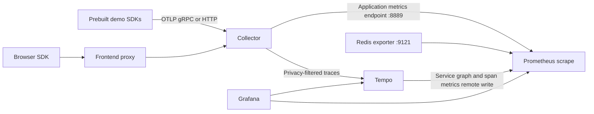

# Instrumentation and AppDynamics Notes

## Prebuilt Instrumentation

Application instrumentation comes from **OpenTelemetry Demo 3.1.0 images**, not newly written application code or agents injected by this project.

- Go catalog/checkout, JavaScript frontend/payment, .NET cart, and the supporting services already include OpenTelemetry instrumentation.
- [Shared environment](../../kubernetes/common/app.env) configures service addresses, resource attributes, OTLP, and cumulative metrics.
- Each [service manifest](../../kubernetes/) sets its service name, application port, and any required protocol override.
- The catalog's [SDK file](../../kubernetes/common/sdk.yaml) configures its upstream declarative Go instrumentation.
- PostgreSQL and Redis calls are instrumented by the demo's catalog and cart libraries.
- W3C propagation connects HTTP/gRPC calls. Browser telemetry is forwarded through the storefront proxy's trace-only OTLP route.

No AppDynamics agent, backend, license, or credentials are installed.

## Telemetry Flow

Read configuration beside each component:

1. [Collector](../../kubernetes/otel-collector/config.yaml): Receivers, privacy policy, memory limits, batching, and exporters.
2. [Tempo](../../kubernetes/tempo/config.yaml): Trace storage and metrics-generator processors.
3. [Prometheus](../../kubernetes/prometheus/prometheus.yaml): Collector, Redis, and Tempo scrapes.
4. [Grafana](../../kubernetes/grafana/datasources.yaml): Tempo linked to the Prometheus UID for its service map.

Tempo 2.9 span-metrics latency is measured in seconds. These metrics describe observed spans, not a complete business-correctness SLI.

## Service Map Checks

Generate traffic, then open **Grafana -> Explore -> Tempo -> Service graph**. Check:

- Frontend -> checkout, catalog, cart, and supporting services.
- Checkout -> payment and email.
- Cart -> Redis and catalog -> PostgreSQL.

Search `{ resource.service.name = "checkout" }` to inspect request traces. In Prometheus, inspect `traces_service_graph_request_total` and `traces_spanmetrics_calls_total`.

Missing edges can mean no recent traffic, lost context, absent spans, or backend configuration failures. The map is not a guaranteed inventory.

## Privacy and Operational Limits

- The `emitRawPii` feature flag is fixed off.
- Collector processing removes sensitive attribute keys, SQL text, and connection strings before export.
- Accepted log bodies are replaced and sent only to the basic debug exporter; no centralized searchable log store exists.
- The upstream cart logs its connection string at informational level. Its specific logging category is set to Warning to suppress that message.
- Raw container logs are not comprehensively redacted by the Collector. Never enter real customer or payment data.
- In-memory export queues and bounded retries can lose telemetry during long outages; local trace storage is not a backup.

Runtime tracing, metrics, and Redis replacement still need verification after sufficient Docker memory is available.

## Future AppDynamics Integration

The directory name preserves the original documentation request. Before adding AppDynamics, consult the official documentation for the exact licensed product/version, supported OpenTelemetry ingestion endpoint/protocol, authentication, and resource mapping.

Supply credentials through secrets, retain the existing Tempo path, and verify continuity and privacy. Do not assume an arbitrary AppDynamics controller accepts standard OTLP directly.

## Upstream Evidence

- [Core service configuration](https://github.com/open-telemetry/opentelemetry-demo/blob/3.1.0/compose.yaml)
- [Catalog instrumentation](https://github.com/open-telemetry/opentelemetry-demo/blob/3.1.0/src/product-catalog/main.go)
- [Cart instrumentation](https://github.com/open-telemetry/opentelemetry-demo/blob/3.1.0/src/cart/src/Program.cs)
